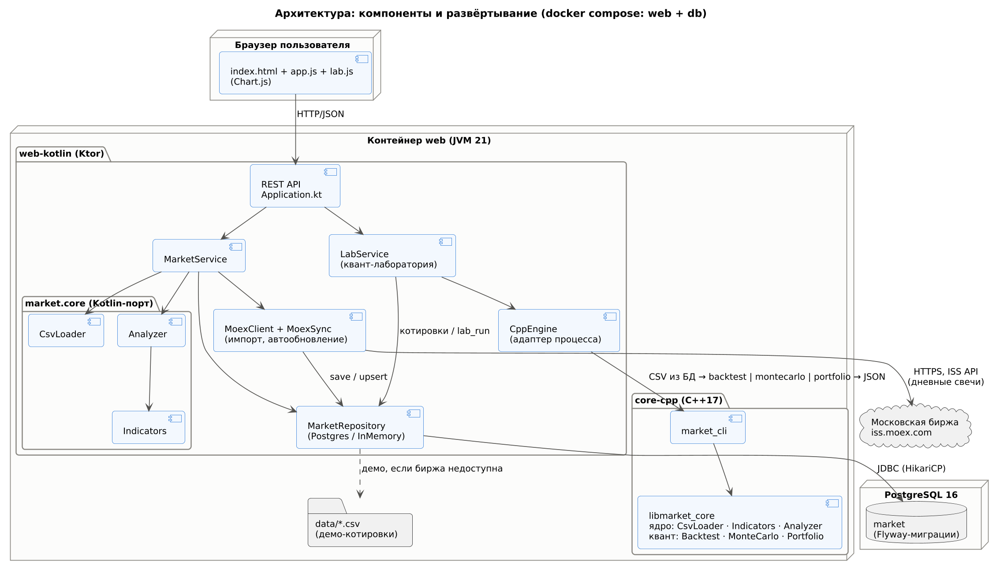
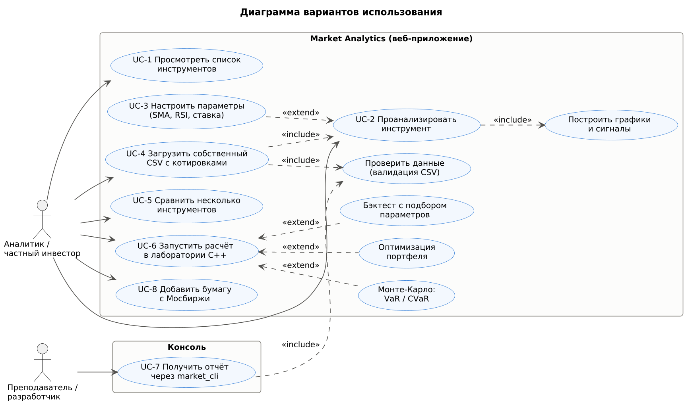
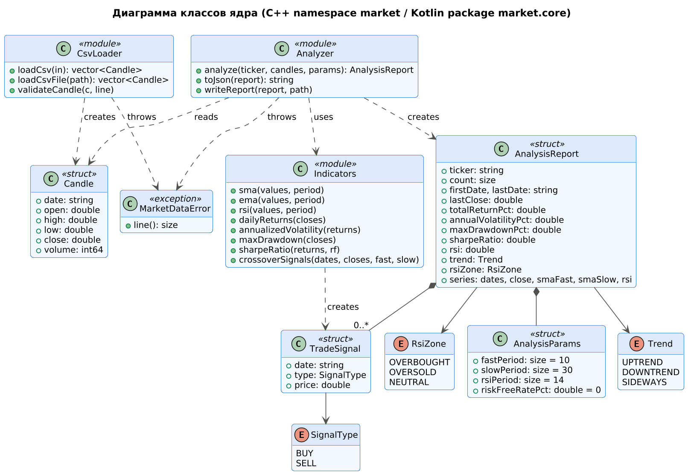
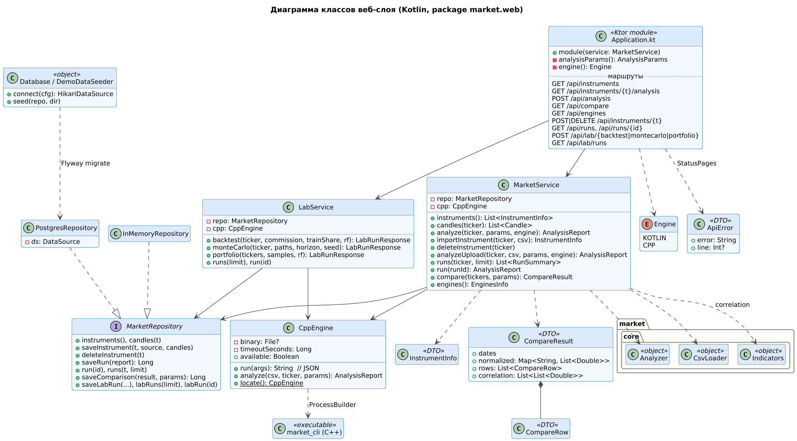
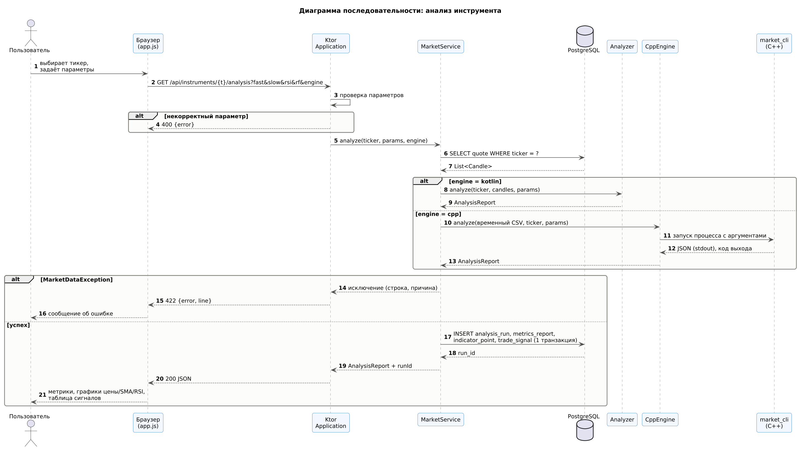
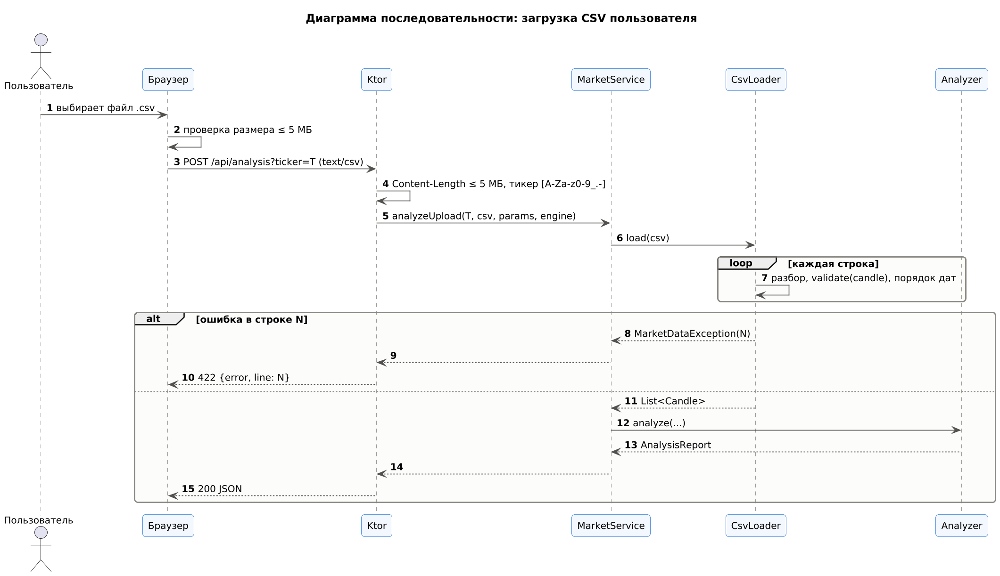
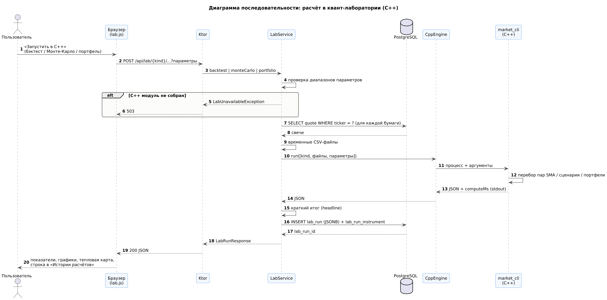
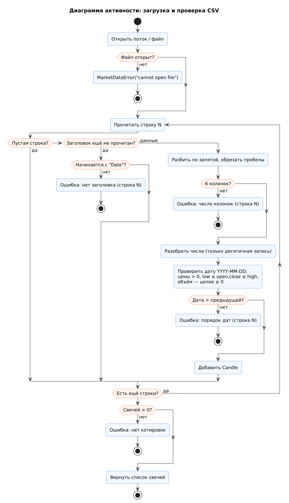
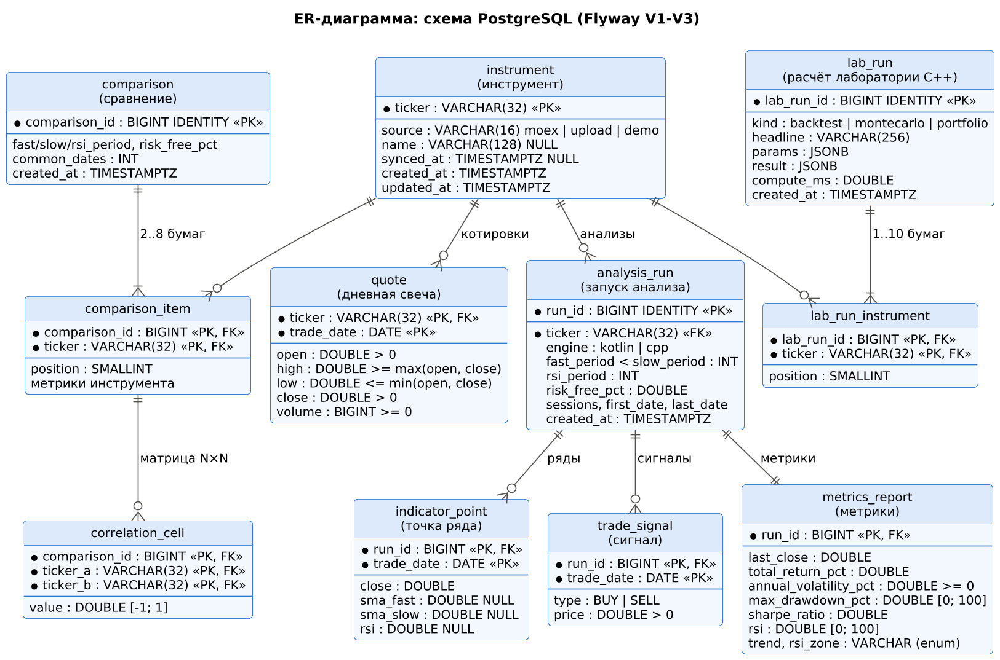

# 2. Проектирование и архитектура

Исходники диаграмм — PlantUML в [`docs/uml`](uml), отрисованные PNG — в [`docs/img`](img).
Пересборка: `java -jar plantuml.jar -tpng -o ../img docs/uml/*.puml`.

## 2.1 Архитектура модулей



Система разделена на три слоя:

| Слой | Модуль | Ответственность |
|---|---|---|
| Представление | `web-kotlin/src/main/resources/static` | SPA на HTML/JS + Chart.js: каталог, анализ, сравнение, загрузка CSV (`app.js`); квант-лаборатория (`lab.js`) |
| Прикладной (Kotlin) | `market.web` (Ktor) | REST API, валидация параметров, маппинг ошибок в HTTP-коды, интерактивный анализ, сравнение и корреляция; `LabService` готовит данные для C++ и хранит результаты |
| Доменный (ядро) | `core-cpp` (C++17) и `market.core` (Kotlin-порт) | Чтение/проверка CSV, индикаторы, метрики, сигналы, формирование отчёта (интерактивный анализ в UI выполняет Kotlin) |
| Вычислительный (C++) | `core-cpp`: `Backtest`, `MonteCarlo`, `Portfolio` + `market_cli` | Бэктест с перебором параметров и проверкой вне выборки, Монте-Карло (VaR / CVaR), оптимизация портфеля |
| Хранение | `market.web.storage` + PostgreSQL 16 | Инструменты, котировки, история запусков анализа и сравнений; миграции Flyway; в режиме без БД — хранилище в памяти |
| Источник котировок | `market.web.moex` → ISS API Мосбиржи | `MoexClient` (HTTP + разбор блоков ISS, пагинация, валидация свечей), `MoexSync` (импорт, дозагрузка, фоновое обновление) |
| Резервные данные | `data/*.csv` | Синтетические демо-котировки — только если биржа недоступна, а база пуста |

Ключевые решения:
1. **Ядро не зависит от веба.** C++ ядро — статическая библиотека `market_core`, к ней подключены CLI и тесты; Kotlin-ядро — пакет без зависимостей от Ktor.
2. **Разделение ролей по характеру нагрузки.** Kotlin — сервис (сеть, БД, API, лёгкий интерактивный анализ); C++ — тяжёлые расчёты лаборатории (сотни тысяч сценариев и вариантов). Подробное обоснование — [03-cpp-vs-kotlin.md](03-cpp-vs-kotlin.md).
3. **Интеграция C++ через процесс** (а не JNI): проще собрать и отладить, падение C++ не роняет JVM, есть таймаут (120 с). Накладные расходы на запуск процесса (≈ 4 мс) несущественны на фоне расчёта лаборатории. Результат — JSON в stdout, Kotlin сохраняет его в `lab_run` как JSONB.
4. **Ошибки данных — исключения с номером строки** (`MarketDataError` / `MarketDataException`), на HTTP-уровне превращаются в 422 `{error, line}`.
5. **Отсутствующие значения**: в C++ — `NaN` (в JSON → `null`), в Kotlin — `Double?` (null-safety), в БД — `NULL`.
6. **Хранилище за интерфейсом** `MarketRepository`: `PostgresRepository` (JDBC + HikariCP) в рабочем режиме и `InMemoryRepository` для запуска без БД и быстрых тестов. Один и тот же контрактный набор тестов прогоняется на обеих реализациях.

## 2.2 Варианты использования



## 2.3 Диаграммы классов

Ядро (одинаковая структура в C++ и Kotlin):



Веб-слой:



## 2.4 Диаграммы последовательности







## 2.5 Алгоритм проверки CSV



## 2.6 Модель данных (ERD) и хранение в PostgreSQL



Схема создаётся миграциями Flyway [`V1__init_schema.sql`](../web-kotlin/src/main/resources/db/migration/V1__init_schema.sql)
[`V2__moex_source.sql`](../web-kotlin/src/main/resources/db/migration/V2__moex_source.sql) (источник `moex`, `name`, `synced_at`)
и [`V3__lab_runs.sql`](../web-kotlin/src/main/resources/db/migration/V3__lab_runs.sql) (история лаборатории)
при старте приложения; применённые миграции повторно не выполняются.

| Таблица | Назначение | Ключ |
|---|---|---|
| `instrument` | инструмент, источник (`moex` / `upload` / `demo`), наименование, время синхронизации с биржей | `ticker` |
| `quote` | дневные котировки | `(ticker, trade_date)` |
| `analysis_run` | запуск анализа: движок, параметры, период | `run_id` (identity) |
| `metrics_report` | метрики запуска (1:1 с `analysis_run`) | `run_id` |
| `indicator_point` | снимок рядов цены, SMA и RSI на момент запуска | `(run_id, trade_date)` |
| `trade_signal` | сигналы BUY / SELL | `(run_id, trade_date)` |
| `comparison`, `comparison_item`, `correlation_cell` | сохранённые сравнения и матрица корреляций | `comparison_id` (+ тикеры) |
| `lab_run`, `lab_run_instrument` | расчёты лаборатории C++: вид, параметры и результат (JSONB), итог, время расчёта; связь с бумагами | `lab_run_id` |

Решения по хранению:
- **Целостность на уровне БД**: внешние ключи с `ON DELETE CASCADE` (удаление инструмента удаляет его котировки, историю и участие в сравнениях) и `CHECK`-ограничения, повторяющие проверки CSV (`low ≤ open, close ≤ high`, цены > 0, `fast < slow`, RSI в [0; 100]). Даже если обойти валидацию в коде, БД не примет некорректную свечу.
- **Транзакции**: импорт котировок (upsert инструмента + замена всех свечей) и сохранение запуска (5 таблиц) выполняются атомарно; при ошибке всё откатывается.
- **Пакетная вставка**: `addBatch` + `reWriteBatchedInserts=true` — 500 свечей и 500 точек ряда вставляются несколькими запросами.
- **Снимок рядов** в `indicator_point`: перезагрузка котировок не меняет уже сохранённые отчёты — старый запуск открывается ровно таким, каким был.
- **`DOUBLE PRECISION`** вместо `NUMERIC`: расчёты ведутся в `double`, поэтому значения из БД бит-в-бит совпадают с разобранными из CSV, и паритет с C++ ядром сохраняется.
- **Индекс** `analysis_run (ticker, created_at DESC)` — для истории запусков по инструменту.

Конфигурация: `MARKET_DB_URL` (например `jdbc:postgresql://db:5432/market`), `MARKET_DB_USER`, `MARKET_DB_PASSWORD`.
Без `MARKET_DB_URL` приложение работает с хранилищем в памяти (данные теряются при перезапуске).

## 2.7 REST API

| Метод | Путь | Параметры | Ответ |
|---|---|---|---|
| GET | `/api/health` | — | `{"status","storage","storageHealthy"}`; 503, если БД недоступна |
| GET | `/api/lab/status` | — | `{"available": true/false}` — собран ли C++ модуль |
| GET | `/api/instruments` | — | `InstrumentInfo[]` |
| POST | `/api/instruments/{ticker}/moex` | — | 201 `InstrumentInfo`; история за 3 года с Мосбиржи (404 — тикера нет, 502 — биржа недоступна) |
| POST | `/api/instruments/{ticker}/refresh` | — | догрузить свежие свечи с биржи |
| GET | `/api/sync` | — | состояние фоновой синхронизации с биржей |
| POST | `/api/instruments/{ticker}` | тело — CSV | 201 `InstrumentInfo`; создаёт или заменяет котировки в БД |
| DELETE | `/api/instruments/{ticker}` | — | 204; каскадно удаляет историю |
| GET | `/api/instruments/{ticker}/candles` | — | `Candle[]` |
| GET | `/api/instruments/{ticker}/analysis` | `fast, slow, rsi, rf` | `AnalysisReport` с `runId`; запуск сохраняется в БД |
| POST | `/api/lab/backtest/{ticker}` | `commission` (0–2 %), `train` (0.5–0.9), `rf` | `LabRunResponse` — расчёт C++ |
| POST | `/api/lab/montecarlo/{ticker}` | `paths` (1 000–200 000), `horizon` (5–252), `seed` | `LabRunResponse` |
| POST | `/api/lab/portfolio` | `tickers=A,B,…` (2–10), `samples` (1 000–500 000), `rf` | `LabRunResponse` |
| GET | `/api/lab/runs`, `/api/lab/runs/{id}` | `limit` | история лаборатории / сохранённый расчёт |
| POST | `/api/analysis` | `ticker, fast, slow, rsi, rf`; тело — CSV | `AnalysisReport` (разовый анализ, без сохранения) |
| GET | `/api/runs` | `ticker`, `limit` (1–200, по умолч. 20) | `RunSummary[]`, новые первыми |
| GET | `/api/runs/{id}` | — | сохранённый `AnalysisReport` |
| GET | `/api/compare` | `tickers=A,B,…` (2–8), `fast, slow, rsi, rf` | `CompareResult` с `comparisonId` (сохраняется в БД) |

Коды ошибок: **400** — неверный параметр/тикер/движок; **404** — инструмент не найден;
**422** — ошибка данных (`{"error": "...", "line": N}`); **502** — Мосбиржа недоступна; **503** — нет C++ модуля; **500** — непредвиденная ошибка (логируется).

Пример:

```bash
curl -X POST "http://localhost:8080/api/lab/montecarlo/SBER?horizon=21&paths=50000"
```

## 2.8 Котировки Московской биржи

```
MoexClient ──HTTP──▶ iss.moex.com/iss/engines/stock/markets/{shares/boards/TQBR | index}/securities/{T}/candles.json?interval=24
    │  разбор блоков ISS {"columns":[...],"data":[[...]]}, пагинация по start, валидация каждой свечи
    ▼
MoexSync ── import: история за N лет → saveInstrument(source = moex)
         ── refresh: последние 7 дней → upsertQuotes (ON CONFLICT (ticker, trade_date) DO UPDATE)
         ── syncAll: при старте и каждые MARKET_REFRESH_HOURS часов (корутина Ktor, Dispatchers.IO)
```

Обработка сбоев: сетевые ошибки и 5xx → `MoexUnavailableException` (HTTP 502; фоновая синхронизация
прекращается до следующего цикла, сохранённые данные остаются доступны); пустая выдача на обоих рынках →
`MoexNotFoundException` (404); некорректная свеча (например, high < close) пропускается с записью в лог.
Клиент проверяется автотестами на локальной заглушке ISS (`FakeIss`), повторяющей формат и постраничную выдачу.

## 2.9 Развёртывание (Docker Compose)

`compose.yaml` поднимает два сервиса: `db` (PostgreSQL 16, данные в томе `pgdata`, healthcheck `pg_isready`)
и `web` (образ из многоэтапного `Dockerfile`: сборка C++ → сборка Kotlin → JRE-образ с `market_cli` внутри).
`web` стартует только после того, как БД готова, сам применяет миграции и импортирует демо-данные.
Профиль `test` запускает все тесты C++ и Kotlin против отдельной базы `market_test`.

## 2.10 Структура репозитория

```
core-cpp/            C++17: include/market/*.hpp, src/*.cpp, app/main.cpp, tests/*.cpp (GoogleTest)
web-kotlin/          Kotlin/Ktor: market.core (порт), market.web (API), market.web.storage (PostgreSQL), static (UI), db/migration (Flyway), тесты
data/                демо-котировки (синтетические)
deploy/postgres/     init-скрипт PostgreSQL (база для тестов)
Dockerfile, compose.yaml  контейнеризация: web + PostgreSQL
tools/               генератор демо-данных
docs/                требования, архитектура, UML, сравнение, отчёт о тестировании, презентация
.github/workflows/   CI: сборка и тесты C++ и Kotlin
```
